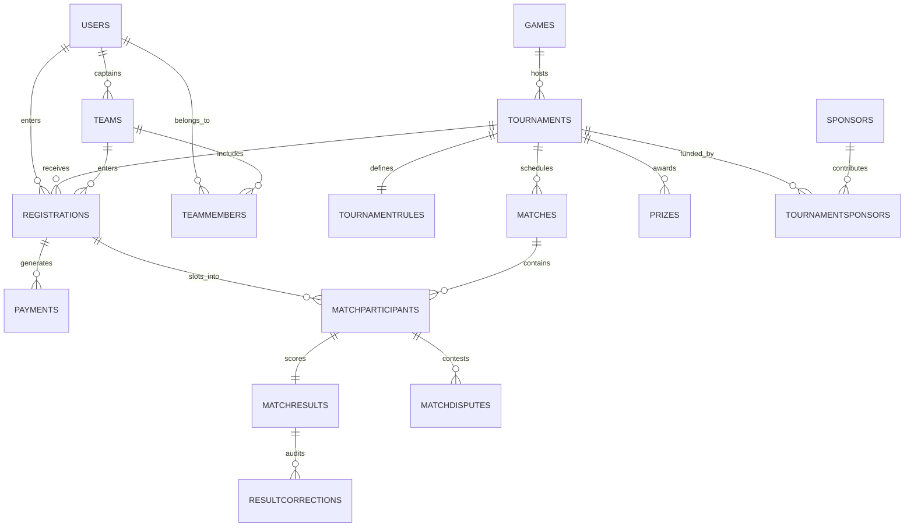

# ArenaHQ — Gaming Tournament Management System

A production-grade, full-stack esports tournament web application engineered according to the official **DBMS Project Specification**. ArenaHQ eliminates spreadsheet confusion by providing an auditable, normalized 3NF relational database on MySQL 8.0 with automated integrity checks, database triggers, role-based access control, unified solo/team registrations, competitive match bracket management, conflict dispute handling, and financial ledgers denominated in **Indian Rupees (₹ INR)**.

---

## 🏆 Complete Project Modules (All 6 Modules Implemented)

### Module 1 — User & Profile Management
- User registration, authentication, JWT tokens with secure cookie/header authorization, and bcrypt password hashing.
- Profile management: inspection and editing of profile details (country, email, password update).
- Role-Based Access Control (RBAC) separating **Players**, **Team Captains**, and **Administrators**.

### Module 2 — Game & Tournament Management
- Games catalog (`Games`) storing esports titles, platforms (PC, PS5, Xbox, Mobile), publishers, and genres.
- Tournament management (`Tournaments`) supporting tournament formats (Single Elimination, Double Elimination, Round Robin), entry fees in INR (₹), capacity limits, and lifecycle statuses (`Upcoming`, `Open`, `Ongoing`, `Completed`, `Cancelled`).
- 1:1 Tournament Rules (`TournamentRules`) storing `participation_type` (Solo vs Team), `team_size`, `min_age`, `region_restriction`, and official rulebooks.
- Real-time tournament search and multifaceted filtering (game, format, status).

### Module 3 — Team Management
- Squad creation designating the creator as **Captain** atomically across `Teams` and `TeamMembers`.
- Team roster tracking with composite primary key `(team_id, user_id)`.
- Captain permissions: invite members, update roster roles (`Captain`, `Starter`, `Substitute`), remove members, or disband squad.
- Roster membership controls allowing players to join or leave squads.

### Module 4 — Unified Registration Management
- Unified `Registrations` table for both individual players and competitive teams.
- Strict exclusive-arc constraint:
  ```sql
  CONSTRAINT chk_one_entrant CHECK ((user_id IS NULL) <> (team_id IS NULL))
  ```
- Unique constraints preventing duplicate solo and team signups:
  ```sql
  UNIQUE(tournament_id, user_id);
  UNIQUE(tournament_id, team_id);
  ```
- MySQL Triggers and transaction row locking enforcing registration deadlines, status validation, participation type matching, and maximum participant caps.
- Lifecycle workflow: `Pending` ➔ `Approved`, `Rejected`, or `Cancelled`.
- Audit integrity: cancelled entries are never physically deleted (`DELETE`); status transitions preserve full historical records.

### Module 5 — Match Scheduling & Results Management
- **Matches (`Matches`)**: Schedule tournament rounds (Quarterfinals, Semifinals, Grand Finals), match numbering, scheduled timestamps, and statuses (`Scheduled`, `Live`, `Completed`, `Cancelled`). Unique constraint `(tournament_id, round_name, match_number)` guarantees bracket integrity.
- **Match Participants (`MatchParticipants`)**: Assign approved registrations to match slots with composite primary key `(match_id, registration_id)` and unique slot constraints `(match_id, slot_number)`. Database trigger `trg_before_insert_match_participant` verifies that participant registrations belong strictly to the match's parent tournament.
- **Match Results (`MatchResults`)**: Record participant scores and outcomes (`Win`, `Loss`, `Draw`, `Forfeit`). FK referencing `(match_id, registration_id)` ensures scores can only be recorded for assigned entrants.
- **Match Disputes (`MatchDisputes`)**: Participants and team captains can raise dispute claims (`Open`, `Under Review`, `Resolved`, `Rejected`) directly from the Match Center with claim descriptions and timestamps.
- **Result Corrections (`ResultCorrections`)**: Authorized administrators can adjust previously recorded match results with full audit history, logging `old_score`, `new_score`, timestamp, and optional dispute reference.

### Module 6 — Payments and Prizes Management
- **Payments (`Payments`)**: Track entry fee transactions associated with tournament registrations in **Indian Rupees (₹ INR)**. Supports `Pending`, `Success`, `Failed`, and `Refunded` statuses, transaction references, and payment methods (UPI, NetBanking, Credit Card, Debit Card).
- **Prizes (`Prizes`)**: Allocate placement prize pools in **Indian Rupees (₹ INR)** with unique placement constraints per tournament `UNIQUE(tournament_id, placement)`. Database triggers `trg_before_insert_prize` and `trg_before_update_prize` ensure awarded winners belong to that tournament.
- **Sponsors (`Sponsors`)**: Central brand partner catalog storing corporate entity names, contact emails, and country.
- **Tournament Sponsorships (`TournamentSponsors`)**: M:N relational bridge table with composite primary key `(tournament_id, sponsor_id)` tracking brand funding capital contributed to each tournament in **Indian Rupees (₹ INR)**.

---

## 🇮🇳 Currency Standardization (Indian Rupees — ₹)

All monetary representations throughout ArenaHQ use **Indian Rupees (₹)**:
- **Consistent Helper**: Frontend utilizes `formatINR()` located in `src/utils/currency.ts` leveraging the `en-IN` locale and guaranteed `₹` symbol prefix (e.g., `₹50,000.00`, `₹1,500.00`).
- **Preserved Numeric Values**: Numeric figures in the database and APIs remain clean floats/decimals without artificial unit conversions.
- **Universal Application**: Entry fees, payment transaction amounts, placement prize rewards, net revenue aggregates, and sponsor capital contributions all render in INR across cards, tables, dashboards, modals, and detail pages.

---

## 🛠️ Technology Stack

| Layer | Technologies |
|---|---|
| **Frontend** | React 18, TypeScript, Vite, Tailwind CSS, Lucide Icons, Axios, React Router v6 |
| **Backend** | Node.js, Express, TypeScript, `mysql2/promise` (Connection Pooling & ACID Transactions), bcryptjs, jsonwebtoken, cors, dotenv |
| **Database** | MySQL 8.0 Server (Normalized 3NF, Foreign Keys, Triggers, Check Constraints, Composite Keys) |
| **Testing** | Jest, Supertest, ts-jest (43 automated integration test cases verified) |
| **DevOps & CI/CD** | Docker, Docker Compose, GitHub Actions, GitHub Pages SPA Deployment |

---

## 📊 Database Design & Relational Model (3NF)

The system fully implements all **16 relational tables** from the DBMS project document:



### Database Integrity Triggers
1. `trg_before_insert_registration`: Enforces the exclusive entrant rule `(user_id IS NULL) <> (team_id IS NULL)`.
2. `trg_before_update_registration`: Validates allowed status transitions.
3. `trg_before_insert_match_participant`: Verifies assigned entrant registration belongs to the match's tournament.
4. `trg_before_insert_prize` & `trg_before_update_prize`: Validates that any awarded winner registration belongs to the tournament awarding the prize.

---

## 🚀 Quick Start & Local Setup

### Prerequisites
- **Node.js** (v18 or v20+)
- **MySQL Server 8.0** running locally on port 3306

### 1. Database Initialization
Execute the SQL initialization scripts in order:

```bash
mysql -u root -p gaming_tournament_db < database/01_schema.sql
mysql -u root -p gaming_tournament_db < database/02_triggers.sql
mysql -u root -p gaming_tournament_db < database/03_seed.sql
```

### 2. Backend Setup
```bash
cd backend
npm install
cp ../.env.example .env
# Edit .env with your MySQL credentials (DB_USER, DB_PASSWORD, DB_NAME)
npm run dev
```
Backend runs at `http://localhost:5000`.

### 3. Frontend Setup
```bash
cd ../frontend
npm install
npm run dev
```
Frontend runs at `http://localhost:5173`.

---

## 👥 Demo Personas

The database comes pre-seeded with realistic esports tournament data and quick persona logins:

| Username | Role / Team | Password | Permissions & Scope |
|---|---|---|---|
| `admin` | **Administrator** | `Admin@123` | Full access to all 6 modules, dispute review, score corrections, financial ledger, and prizes. |
| `shroud_jr` | **Player / Captain** | `Player@123` | Captain of team **Sentinels**, registered in Valorant Champions. Can raise disputes and pay entry fees. |
| `s1mple_king` | **Player / Captain** | `Player@123` | Captain of team **Natus Vincere (NAVI)**, registered in CS2 Major. |
| `soloplayer1` | **Player (Solo)** | `Player@123` | Solo entrant in Tekken 8 Masters. |

*Use the **Demo Switcher** in the top navigation bar to switch personas instantly with one click.*

---

## 🧪 Automated Integration Tests

All 6 test suites and **43 test cases** run against the local MySQL 8.0 database:

```bash
cd backend
npm test
```

### Test Suite Summary:
- `src/tests/auth.test.ts` (Module 1): Registration, duplicate username handling, password verification, JWT token issuance, protected route access.
- `src/tests/games-tournaments.test.ts` (Module 2): Game catalog CRUD, tournament creation, date validation (`end_date > start_date`), rules association.
- `src/tests/teams.test.ts` (Module 3): Squad creation, automatic Captain assignment, roster management, duplicate member rejection.
- `src/tests/registrations.test.ts` (Module 4): Unified registrations, exclusive entrant XOR check, duplicate prevention, status transitions.
- `src/tests/matches.test.ts` (Module 5): Match scheduling, slot assignments, duplicate match number prevention, cross-tournament validation, disputes, and audited result corrections.
- `src/tests/financial.test.ts` (Module 6): Entry fee payments in INR, unique prize placements, cross-tournament prize award rejection, sponsor directory, and tournament sponsorship contributions.

---

lational database query execution without mock data.
